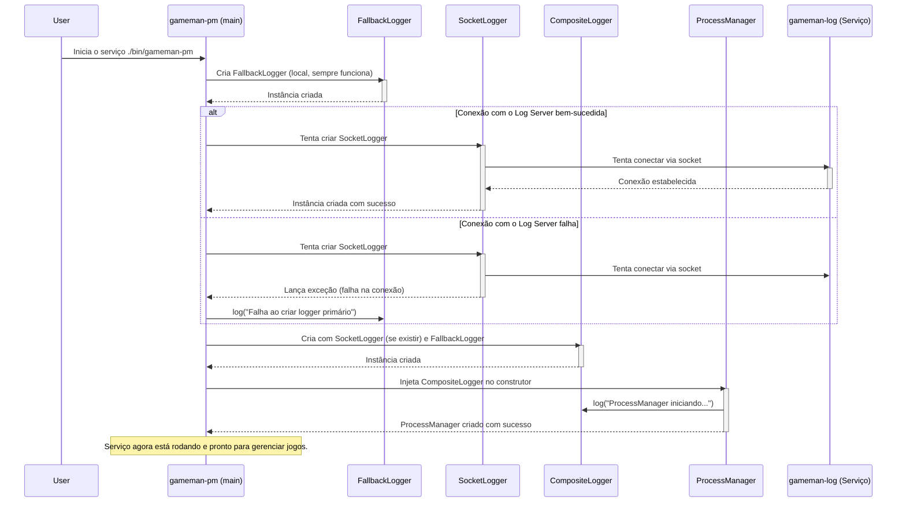

# Arquitetura do Projeto GameMan

Este documento descreve a arquitetura de alto nível e o fluxo de execução do projeto GameMan.

## Princípios de Design

O projeto está evoluindo de um monolito para uma **arquitetura de múltiplos processos (ou microserviços)**, onde cada componente principal é um serviço independente que se comunica com os outros através de interfaces bem definidas (Unix Sockets).

Os princípios chave são:
-   **Modularidade:** Cada componente tem uma única responsabilidade e pode ser desenvolvido, testado e executado de forma independente.
-   **Resiliência:** A falha de um componente (como o serviço de log) não deve causar uma falha em cascata nos outros componentes do sistema.
-   **Desacoplamento:** Os componentes dependem de abstrações (interfaces), não de implementações concretas, permitindo flexibilidade e testabilidade.

## Componentes

### Executáveis (Serviços)

*   **`gameman-log` (anteriormente `logger`):** O serviço de log. É um daemon que escuta em um Unix Socket, recebe mensagens de log de outros serviços e as escreve em um destino configurável (arquivo ou console).
*   **`gameman-pm` (anteriormente `main`):** O serviço de gerenciamento de processos. É o coração do sistema, responsável por iniciar, monitorar e gerenciar o ciclo de vida dos processos de jogos. Futuramente, ele também atuará como um servidor, escutando por comandos de um cliente CLI.

### Lógica do Cliente (dentro do `gameman-pm`)

*   **`ProcessManager`:** A classe central que encapsula a lógica de gerenciamento de processos.
    -   Usa `fork()` e `exec()` para iniciar jogos.
    -   Usa `epoll` com `signalfd` para monitorar de forma assíncrona o término de processos filhos (`SIGCHLD`).
    -   **Não depende mais de um `LogClient` concreto.** Em vez disso, ele recebe uma implementação da interface `ILogger` através de injeção de dependência em seu construtor.

*   **`ILogger` (Interface):** Define o contrato abstrato para qualquer logger que o `ProcessManager` possa usar.

*   **`SocketLogger`, `FallbackLogger`, `CompositeLogger`:** Implementações da interface `ILogger` que fornecem, respectivamente, log via socket, log local de contingência e uma combinação resiliente dos dois.

## Fluxo de Execução (Inicialização Resiliente)

O diagrama de sequência abaixo ilustra o novo fluxo de inicialização do serviço `gameman-pm`, destacando a resiliência do sistema de log.

### Explicação do Fluxo

1.  **Inicialização do `gameman-pm`**:
    *   O `main` do serviço de gerenciamento de processos é iniciado.
    *   Ele primeiro cria um `FallbackLogger`, que é um logger local garantido para funcionar, escrevendo em um arquivo como `pm_fallback.log`.
    *   Em seguida, ele **tenta** criar o `SocketLogger` para se conectar ao serviço `gameman-log`.
        *   **Se for bem-sucedido**, a operação é registrada.
        *   **Se falhar**, a falha é registrada usando o `FallbackLogger`, e a aplicação continua sem o logger primário.
    *   Um `CompositeLogger` é criado, que gerenciará a lógica de usar o `SocketLogger` se ele existir, ou o `FallbackLogger` caso contrário.

2.  **Injeção de Dependência**:
    *   A instância do `CompositeLogger` é **injetada** no construtor do `ProcessManager`.
    *   O `ProcessManager` está completamente alheio a essa complexidade. Ele simplesmente usa a interface `ILogger` que recebeu, sem saber se está logando via socket ou localmente.

3.  **Operação Normal**:
    *   O `ProcessManager` continua sua inicialização (configurando `epoll`, `signalfd`, etc.) e loga seu progresso.
    *   O `CompositeLogger` direciona essas mensagens para o destino apropriado.
    *   O serviço está agora totalmente operacional, independentemente da disponibilidade do serviço de log no momento da inicialização.
