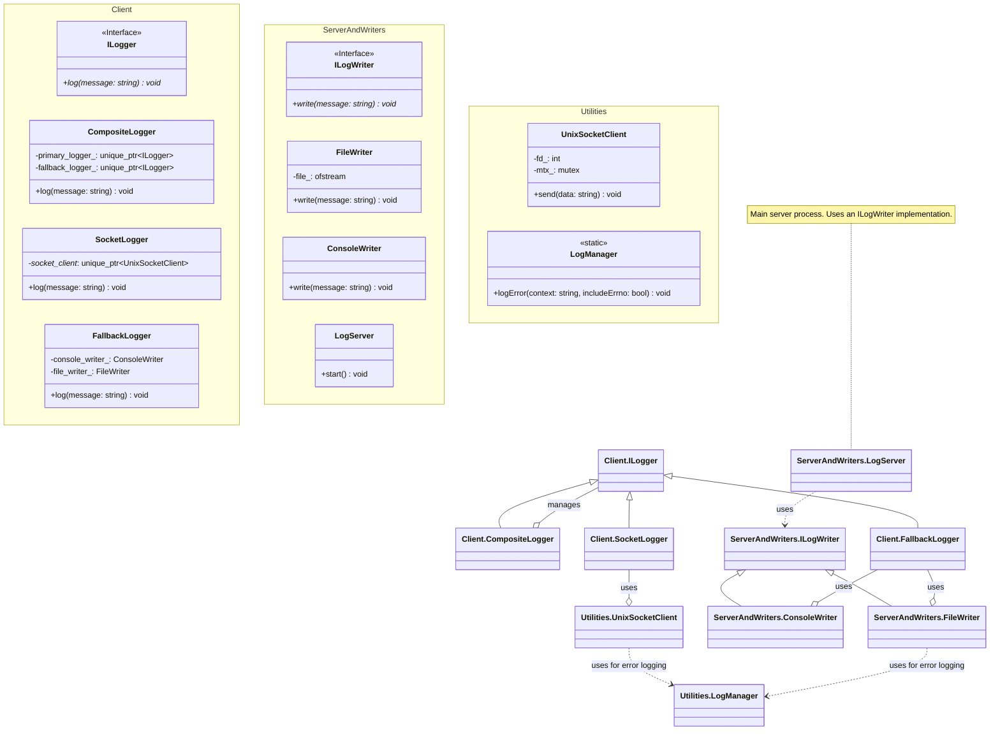

# Diagrama de Classes do Sistema de Log

Este documento contém um diagrama de classes UML, gerado com Mermaid, que descreve a arquitetura do sistema de log. O diagrama foi baseado na análise dos arquivos-fonte localizados no diretório `logs/`.

## Diagrama UML

O diagrama abaixo ilustra as principais classes, interfaces e suas relações, como herança, composição e dependência.

